# Active Directory PowerShell Automation

Three small PowerShell scripts for common Active Directory admin tasks: onboarding users from a CSV, offboarding a departing user, and reporting on locked, disabled, and inactive accounts. They were written and tested against the Windows Server 2025 domain `lab.local` from my [Active Directory home lab](https://github.com/gnbg03/windows-ad-home-lab).

## Scripts

| Script | What it does |
|---|---|
| `New-LabUsers.ps1` | Reads `new-hires.csv` and creates each user in `OU=Employees`, sets "change password at next logon", and adds the user to the group named in the CSV. Skips users that already exist and prints a warning. |
| `Disable-LabUser.ps1` | Offboarding. Disables the account, removes it from every group, moves it to `OU=Disabled` (created if missing), and date-stamps the description. |
| `Get-AccountReport.ps1` | Exports locked, disabled, and inactive (90+ days) user accounts to `locked.csv`, `disabled.csv`, and `inactive.csv`. |
| `new-hires.csv` | Sample input: `FirstName,LastName,Username,Group`. A blank group means the user is created without a group. |

## How to run

Run from an elevated PowerShell on a domain controller (or a machine with the RSAT Active Directory module), from the folder that contains the files:

```powershell
cd C:\Scripts
.\New-LabUsers.ps1                      # prompts for an initial password that meets the domain policy
.\Disable-LabUser.ps1 -Username schen
.\Get-AccountReport.ps1
```

If PowerShell blocks scripts, allow them for the current session only: `Set-ExecutionPolicy -Scope Process Bypass`.

## What happened when I ran them

- **Onboarding:** created `arivera`, `schen`, and `jlee`. Before the run, `Employees` held two users; after, five. `arivera` and `schen` were added to Sales and `jlee` was not, because the CSV leaves the group blank.
- **Duplicate check:** a second run printed "already exists" for all three and created nothing.
- **Offboarding:** `schen` ended up disabled, with the description `Disabled 2026-11-04`, in `OU=Disabled`, and no longer a member of Sales.
- **Report:** `disabled.csv` listed `Guest`, `krbtgt`, and `schen`. `Guest` and `krbtgt` are built-in accounts that are disabled by default, so they show up in every domain's report. `locked.csv` was empty because no account was locked out at the time.

## Troubleshooting

**`Import-Csv` could not find `new-hires.csv`.** The first run failed with `FileNotFoundException`. The script uses a relative path (`.\new-hires.csv`), and my shell was in `C:\Windows\system32`, not the folder with the CSV. I created `C:\Scripts`, put the files there, ran `cd C:\Scripts`, and ran it again. Relative paths depend on the current directory, so run the scripts from their own folder.

## Limitations and next steps

- All new users in one run share the same initial password (each must change it at first logon).
- No `-WhatIf` support or logging to a file yet.
- The report includes built-in accounts such as `Guest` and `krbtgt`. A filter to exclude them would make it cleaner.
- Hard-coded to the `lab.local` domain and the `Employees` and `Disabled` OUs. A next step is to turn these into parameters.

## Screenshots

**1. Troubleshooting: Import-Csv could not find new-hires.csv because the shell was in C:\Windows\system32**

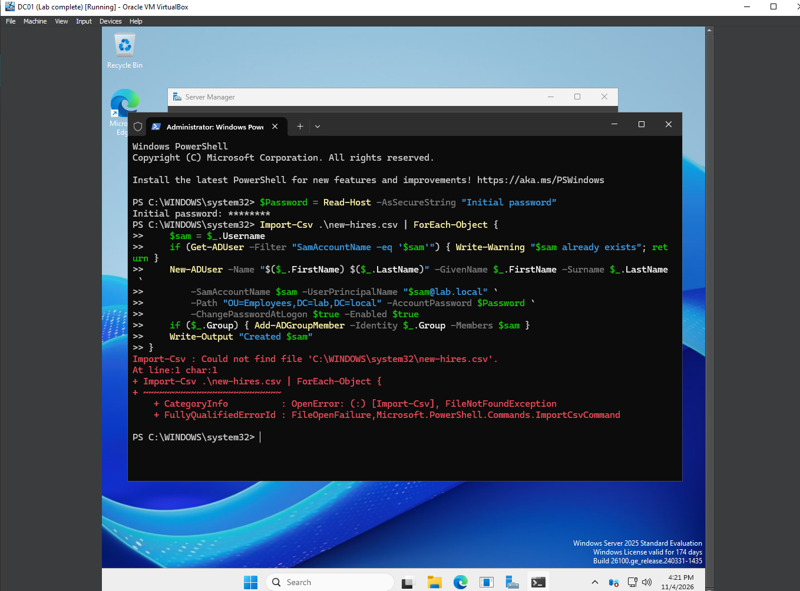

**2. Before: working folder and CSV created; Employees holds only tuser and jdoe, Sales has two members**

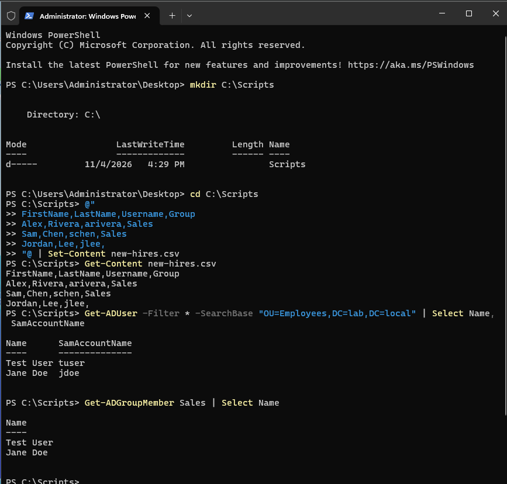

**3. New-LabUsers.ps1 saved in Notepad**

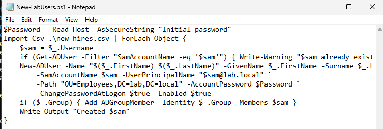

**4. Onboarding script run: arivera, schen, and jlee created**

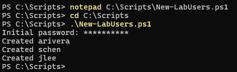

**5. After: five users in Employees, and arivera and schen added to Sales**

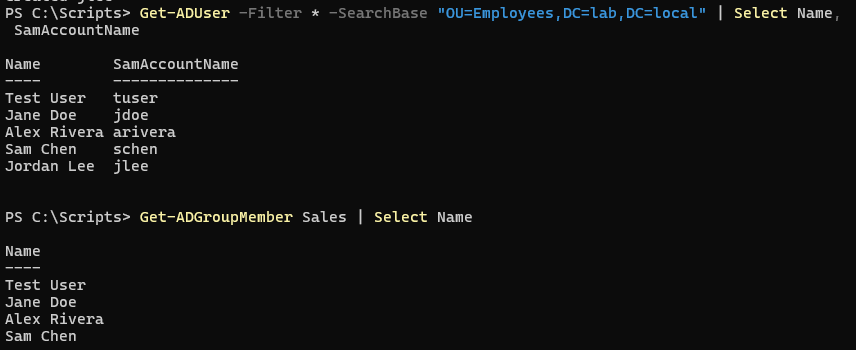

**6. Second run: the duplicate check warns 'already exists' and creates nothing**

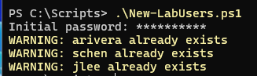

**7. Disable-LabUser.ps1 saved in Notepad**

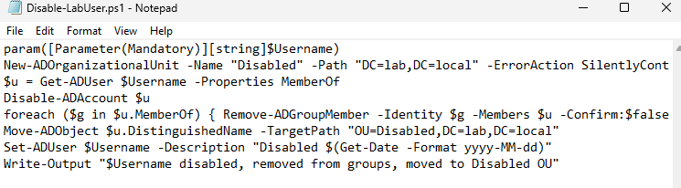

**8. Offboarding schen: disabled, dated description, moved to the Disabled OU, removed from Sales**

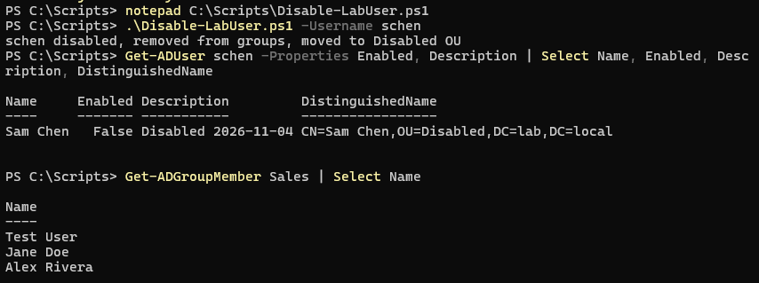

**9. new-hires.csv input file**

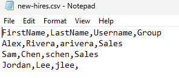

**10. Get-AccountReport.ps1 saved in Notepad**

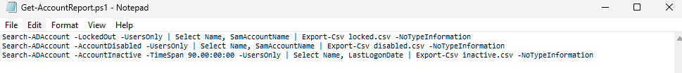

**11. Report run: disabled.csv lists Guest, krbtgt, and schen; the four CSV files created**

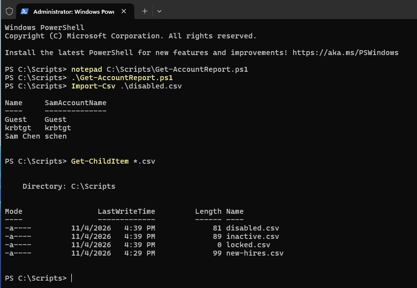

